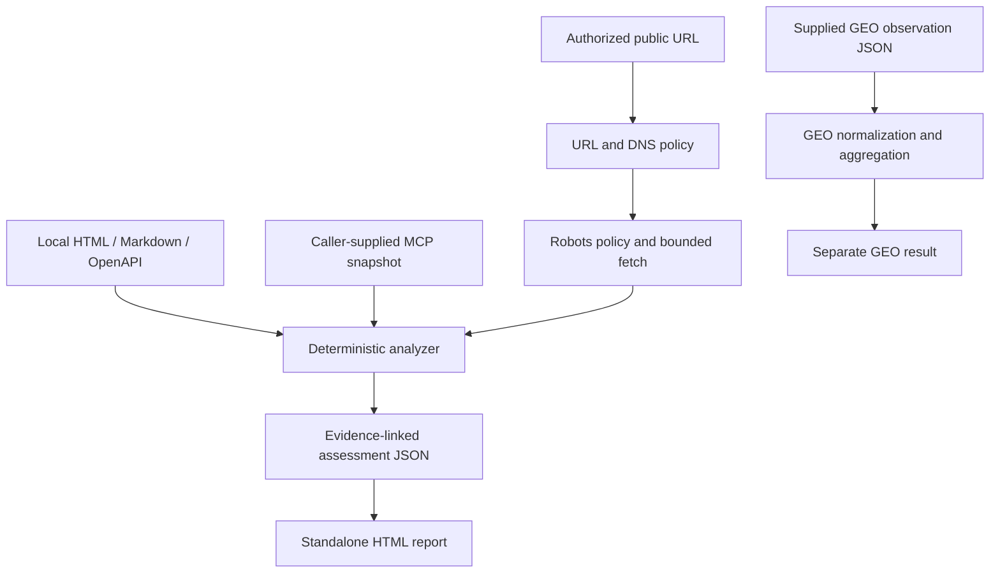

<p align="center">
  <picture>
    <source media="(prefers-color-scheme: dark)" srcset="assets/brand/searqon-wordmark-ivory.svg">
    
  </picture>
</p>

<h1 align="center">Searqon — AI Discoverability and Agent-Readiness Toolkit</h1>

<p align="center">An evidence-first open-source toolkit for developers and technical teams assessing how websites, APIs, documentation and published agent interfaces can be discovered, understood and used.</p>

<p align="center"><strong>Understand Visibility. Engineer Discoverability. Enable Agents.</strong></p>

<p align="center">
  <a href="https://github.com/LloydCoder/tinlance-searqon/actions/workflows/ci.yml"></a>
  <a href="https://github.com/LloydCoder/tinlance-searqon/actions/workflows/codeql.yml"></a>
  <a href="https://github.com/LloydCoder/tinlance-searqon/actions/workflows/secret-scan.yml"></a>
  <a href="LICENSE"></a>
</p>

> **Early alpha.** Searqon is a local-first scanner and analysis toolkit. Read [current capabilities and limitations](docs/SCANNER.md) before using it against a remote target.

## Current workflow

The diagram describes the implemented data paths. It is an architecture illustration, not a screenshot or claim of a hosted service.



## Product direction

Searqon's four-discipline foundation (SEO, AEO, GEO and AgEO) is being extended with an owner-attested Brand Truth Registry, deterministic locale/market prompt cohorts and policy-reviewed, cost-bounded GEO sampling plans. Deterministic, registry-relative brand-claim and citation defense now emits human-review correction manifests. GEO snapshot alert comparisons, raw-observation citation-domain disappearance detection, signed event envelopes and provider payload builders are implemented for supplied data; live acquisition, durable delivery and isolated agent-journey simulation remain future work. The offline Agent Artifact Compiler now produces provenance-linked Markdown/OpenAPI artifacts, optional llms.txt proposals and unapplied deterministic diffs from caller-supplied sources; it does not write repositories or create PRs. See the [architecture specification](docs/ARCHITECTURE_SPEC.md), [module contracts](docs/MODULE_CONTRACTS.md) and [16-phase roadmap](docs/ROADMAP_16_PHASE.md). GEO snapshot comparisons are available through `searqon geo alerts`; see the [alert guide](docs/how-to/compare-geo-snapshots-and-alerts.md).

## Why Searqon

Searqon keeps different kinds of discoverability evidence separate instead of hiding them behind one unexplained score.

| Discipline | What it examines | Current implementation |
|---|---|---|
| SEO | Technical discovery, indexability and page signals | Partial local and single-page diagnostics |
| AEO | Answer structure, clarity and source-oriented content signals | Partial diagnostics |
| GEO | Mentions and citations in generative-system observations | Supplied-observation analysis, brand registry, prompt cohorts, governed sampling preflight and deterministic baseline/current alert comparisons and evidence-linked citation-domain disappearance detection; no live collection or notification delivery |
| AgEO | Documentation and interface readiness for software agents | Partial API, OpenAPI and passive MCP snapshot diagnostics |

Searqon is not a search-rank tracker, a general-purpose crawler, an MCP execution runtime or a hosted monitoring service. It does not guarantee rankings, citations, recommendations or agent adoption. AgEO is Searqon's proposed product discipline, not a universal industry standard.

## Quick Start

Requirements: Node.js 22 or later. The core local CLI uses Node.js built-ins. The web/API and authenticated workspace require the pinned PostgreSQL driver and a configured PostgreSQL database.

```bash
git clone https://github.com/LloydCoder/tinlance-searqon.git
cd tinlance-searqon
node src/cli.js scan ./examples/site.html
```

The command prints a JSON assessment to standard output. Try the [sample HTML input](examples/site.html).

## Installation

### Run from a source checkout

```bash
git clone https://github.com/LloydCoder/tinlance-searqon.git
cd tinlance-searqon
npm ci
npm test
```

### Optional local CLI installation

From the repository root, run `npm link` to expose the package's `searqon` executable on your local PATH. The package is not currently published to the npm registry; do not use `npm install -g @tinlance/searqon` as an installation method.

## Usage

### Analyze a local document

```bash
node src/cli.js scan ./examples/site.html
node src/cli.js scan ./examples/api-docs.md
node src/cli.js scan ./examples/openapi.json
```

Supported local inputs are HTML, Markdown and OpenAPI JSON. The maximum input payload is 2 MiB. MCP analysis accepts a caller-supplied JSON snapshot:

```bash
node src/cli.js scan ./examples/mcp-snapshot.json --format mcp
```

This parses supplied metadata only. It does not connect to an MCP server or invoke tools.

### Scan one authorized public page

```bash
node src/cli.js scan-url https://example.com/docs --confirm-authorized-target
```

The command requires an explicit operator attestation. The scanner retrieves only the selected page, checks robots policy and validates DNS and redirect destinations. Cross-origin redirects are denied unless each destination origin is explicitly authorized:

```bash
node src/cli.js scan-url https://example.com/docs \
  --confirm-authorized-target \
  --allow-redirect-origin https://docs.example.net
```

An allowlist is an operator authorization attestation, not independent proof of ownership. The scanner does not recursively follow page links or render browser JavaScript. See [authorized remote scanning](docs/how-to/authorized-remote-scan.md).

### Analyze supplied GEO observations

```bash
node src/cli.js geo analyze ./examples/geo-observation.json
node src/cli.js geo aggregate ./examples/geo-observations.json
```

These commands do not query AI providers, scrape consumer interfaces or fetch citation URLs. The bundled observations are synthetic fixtures, not live provider data.

Create a Brand Truth Registry, prompt cohort and governed sampling plan:

```bash
node src/cli.js geo registry ./examples/brand-truth-input.json --out ./brand-truth-registry.json
node src/cli.js geo cohort ./examples/geo-cohort-input.json --out ./geo-cohort.json
node src/cli.js geo plan ./examples/geo-sampling-input.json --out ./geo-sampling-plan.json
```

The sampling plan is preflight only: consumer observations require manual capture, model observations require an approved official API adapter, and all tasks are subject to policy review and a hard USD cost cap. See [Create a governed GEO sampling plan](docs/how-to/create-geo-sampling-plan.md).

### Generate a standalone HTML report

```bash
node src/cli.js scan ./examples/site.html --out ./assessment.json
node src/cli.js report ./assessment.json --out ./assessment.html
```

File output uses exclusive-create semantics and refuses to overwrite an existing file. The report is self-contained, escapes untrusted content and loads no remote assets.

## Configuration and options

Searqon currently uses command-line options rather than a configuration file or environment-variable configuration.

| Command | Option | Default / behavior |
|---|---|---|
| `scan` | `--format mcp` | Omit for ordinary HTML, Markdown or OpenAPI analysis |
| `scan` | `--source <label>` | Input filename |
| `scan`, `scan-url`, `geo`, `report` | `--out <path>` | Write JSON or HTML to stdout when omitted |
| `scan-url` | `--confirm-authorized-target` | Required; no default authorization |
| `scan-url` | `--allow-redirect-origin <origin>` | No cross-origin redirects allowed unless explicitly listed; repeatable |
| `scan-url` | `--user-agent <token>` | Product default user agent |
| GEO aggregation API | `timeBucket: "day"` | API default is `"none"`; optional UTC-day cohorts |

The CLI prints usage when invoked without a valid command. Run `node src/cli.js` to see the current command synopsis.

## Features

| Capability | Status and boundary |
|---|---|
| HTML, Markdown and OpenAPI diagnostics | Implemented, rule-based and partial |
| Passive MCP snapshot analysis | Implemented for supplied local JSON; no network connection |
| Authorized remote scan | Implemented for one bounded public page |
| SSRF-oriented URL and DNS controls | Implemented with regression tests; not a complete SSRF certification |
| Robots Exclusion Protocol | Bounded parser, retrieval and process-local cache |
| Evidence records | Versioned records with content digests and provenance metadata |
| Local evidence ledger | Hash-linked JSONL adapter; single-process, not encrypted or WORM-immutable |
| Detached evidence checkpoints | Ed25519 signatures using caller-supplied keys |
| GEO analysis | Normalizes supplied observations and keeps observation classes separate |
| GEO monitoring and provider collection | Not implemented |
| Standalone HTML reports | Implemented; local output only |
| Hosted API, UI and multi-tenant service | Not implemented |

## Local web application

The repository now includes an early local web interface and same-origin assessment API. Run `npm run dev:web` and open `http://127.0.0.1:4173`. The interface uses the existing deterministic analyzer for supplied HTML, Markdown and OpenAPI JSON. Dashboard figures are illustrative only. This is not a hosted, authenticated or multi-tenant service; see [the web application boundary](docs/WEB_APP.md).

## Web application and hosted platform

The repository contains the Searqon landing page and local assessment API. Run `npm run dev:web` and open `http://127.0.0.1:4173`. The PostgreSQL platform schema and tenant-isolation design are documented in [the database foundation](docs/PLATFORM_DATABASE.md). The complete product—including future hosted SaaS capabilities—remains in this repository; see [ADR-0002](docs/adr/0002-single-repository-product.md). The current web server is a local development slice, not a hosted multi-tenant service.

## Authentication and workspace

Passwordless registration, magic-link sign-in and an authenticated workspace shell are available when PostgreSQL and email delivery are configured. See [the authentication guide](docs/AUTHENTICATION.md) and [database foundation](docs/PLATFORM_DATABASE.md). Apply database migrations with `npm run db:migrate`. For local-only email, set `SEARQON_EMAIL_MODE=console` in a non-production environment.

## Documentation

| Guide | Purpose |
|---|---|
| [Documentation index](docs/README.md) | Browse documentation by task |
| [First assessment tutorial](docs/tutorials/first-assessment.md) | Run a first local assessment |
| [Authorized remote scan](docs/how-to/authorized-remote-scan.md) | Scan one public URL safely |
| [Analyze GEO observations](docs/how-to/analyze-geo-observations.md) | Work with supplied GEO samples |
| [CLI reference](docs/reference/cli.md) | Commands and flags |
| [Product charter](docs/PRODUCT_CHARTER.md) | Product scope and intended users |
| [Architecture](docs/ARCHITECTURE.md) | Components and system boundaries |
| [Scanner contract](docs/SCANNER.md) | Inputs, rules and limitations |
| [Reporting](docs/REPORTING.md) | HTML report contract |
| [Security policy](SECURITY.md) | Vulnerability reporting and security controls |
| [Release process](docs/RELEASING.md) | SBOMs, checksums and attestations |
| [Roadmap](docs/ROADMAP.md) | Phases and acceptance gates |
| [Implementation status](docs/EXECUTION_STATUS.md) | Evidence-based delivery status |

## Contributing

Contributions are welcome. Read [CONTRIBUTING.md](CONTRIBUTING.md) before opening a pull request. Security-sensitive changes require dedicated regression tests and a threat-model update.

## License and acknowledgements

Searqon is licensed under the [Apache License 2.0](LICENSE). The package metadata declares the SPDX identifier `Apache-2.0`. Searqon is developed by [Tinlance](https://github.com/LloydCoder).

The Searqon wordmark is approved for use in this project. Light and dark variants are included in [`assets/brand/`](assets/brand/); use the navy variant on light backgrounds and the ivory variant on dark backgrounds. Preserve the supplied proportions, clear space and colors.

<details>
<summary>Roadmap and maturity</summary>

Searqon is in early alpha. The public toolkit is intended to remain independently useful. Live GEO collection, broader crawling, browser rendering, hosted monitoring, tenant management and commercial service capabilities are future work subject to validation and security gates. See [the delivery roadmap](docs/ROADMAP.md).

</details>

<details>
<summary>Troubleshooting</summary>

- **Node version error:** use Node.js 22 or later.
- **Unsupported input:** local scanning currently accepts HTML, Markdown and JSON; MCP snapshots require `--format mcp`.
- **Remote scan rejected:** confirm that you control or are authorized to assess the target, then check DNS, URL, redirect and robots policy.
- **Output already exists:** choose a new `--out` path; file output intentionally does not overwrite.
- **GEO results look empty:** bundled samples are synthetic; the CLI does not collect live provider observations.

</details>

<details>
<summary>Support</summary>

See [SUPPORT.md](SUPPORT.md) for questions, bug reports and security-reporting guidance.

</details>


Audit brand claims and citations with a versioned registry:

```bash
node src/cli.js claims audit examples/claim-defense-input.json --out claim-defense-report.json
```

The report separates registry consistency, potential contradiction, unverified claims, freshness and citation attribution. Proposed corrections require human approval and cannot auto-publish. See [Audit brand claims and citations](docs/how-to/audit-brand-claims.md).
